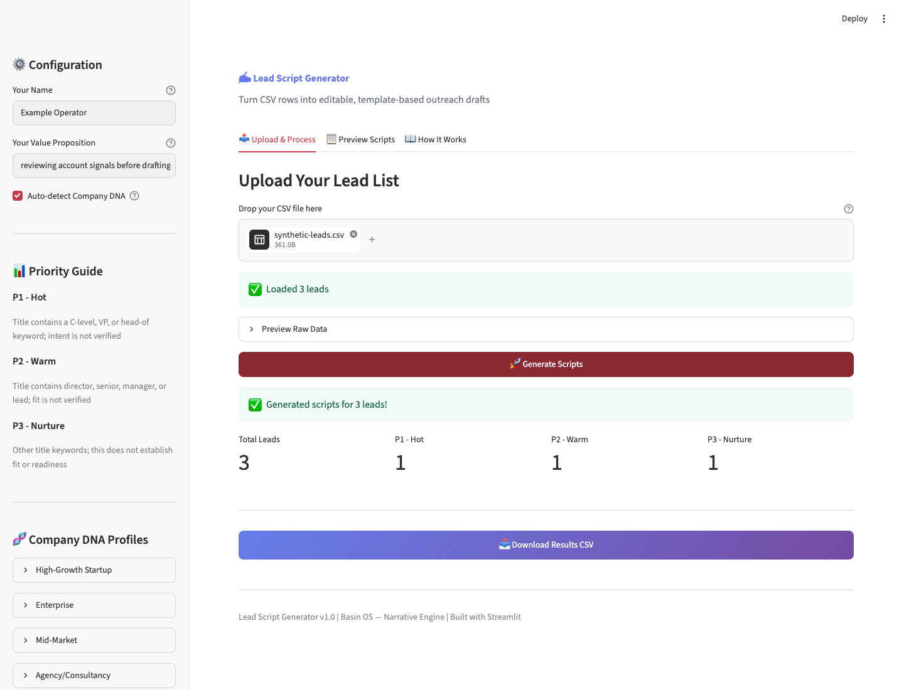

# Lead Script Generator

A Python/Streamlit app that turns a CSV lead list into editable email subjects, email bodies, and LinkedIn drafts using rules and templates.

[Quick start](#quick-start) · [Synthetic input](examples/synthetic-leads.csv) · [Example output](examples/synthetic-results.csv) · [Operating context](https://basinleon.github.io/gtm-systems/)



## What it does

Upload a CSV, set the sender name and value proposition, and generate drafts. The app normalizes common column names, assigns a title-based priority, selects a size/category bucket, and applies a matching text template. Results can be reviewed in the preview tab and downloaded as CSV.

The current implementation does not call Gemini, Claude, or another LLM. No API key is required. It does not send emails, post LinkedIn messages, enrich contacts, or verify account signals.

## Quick start

Requires Python 3.10 or newer:

```sh
git clone https://github.com/BasinLeon/lead-script-generator.git
cd lead-script-generator
python3 -m venv .venv
source .venv/bin/activate
python -m pip install -r requirements.txt
python -m streamlit run app.py
```

On Windows, activate with `.venv\Scripts\activate` instead. Open the local address printed by Streamlit, usually `http://localhost:8501`.

For the documented example:

1. Set **Your Name** to `Example Operator`.
2. Set **Your Value Proposition** to `reviewing account signals before drafting outreach`.
3. Leave **Auto-detect Company DNA** checked.
4. Upload `examples/synthetic-leads.csv` and choose **Generate Scripts**.
5. Inspect **Preview Scripts** or download the CSV.

The screenshot and example output use only fictional contacts and reserved example domains. Checked with Python 3.13, Streamlit 1.67, and pandas 3.1 on November 13, 2026. No hosted app is advertised here; the local instructions are the runnable demo.

## Inspect the rules

| Fictional company | Title | Employees | Result |
| --- | --- | --- | --- |
| Northstar Demo | VP of Sales | 25 | P1 - Hot / High-Growth Startup |
| Harbor Demo | Director of Operations | 250 | P2 - Warm / Mid-Market |
| Meadow Demo | Operations Analyst | 1,200 | P3 - Nurture / Enterprise |

Priority is assigned from title keywords. The category called “Company DNA” comes primarily from employee count, then company-name keywords, with Mid-Market as a fallback. These labels are heuristics, not verified intent or organizational research.

## CSV format

Recommended columns: `first_name`, `last_name`, `company`, `title`, `email`, `linkedin`, and `employees`. Common aliases include `name`, `company_name`, `organization`, `job_title`, and `email_address`. The synthetic example supplies every column to make the result easy to reproduce.

Output includes the normalized contact fields, `Priority`, `Company DNA`, `Email Subject`, `Email Body`, and `LinkedIn Message`.

## Limits

- Templates can contain unsupported assumptions and generic claims. Review and rewrite the drafts before using them.
- Title seniority and employee count do not establish authority, fit, growth, or buying intent.
- This app does not measure response rates or revenue, so generation does not establish that a message is high-converting.
- Malformed or missing values need cleaning before upload. The prototype is not a validated production ingestion pipeline.
- Use synthetic data for evaluation. A shared deployment receives uploaded files on its server.

Built by [Leon Basin](https://basinleon.github.io/). [Public operating record](https://basinleon.github.io/build-record/).
